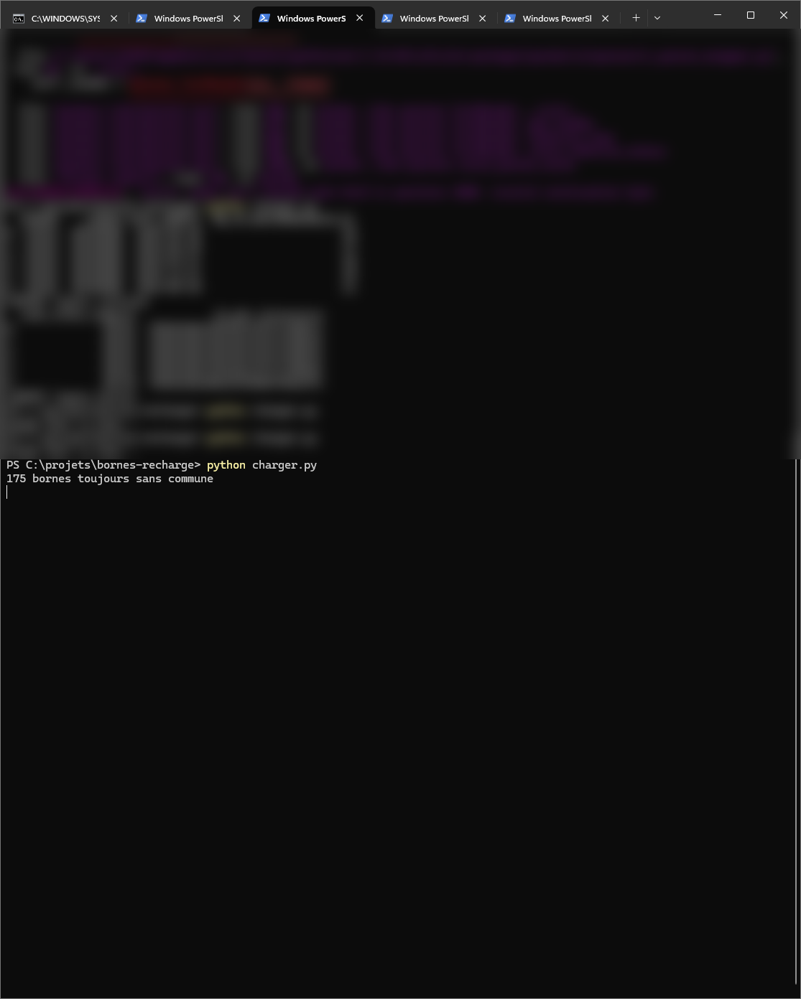
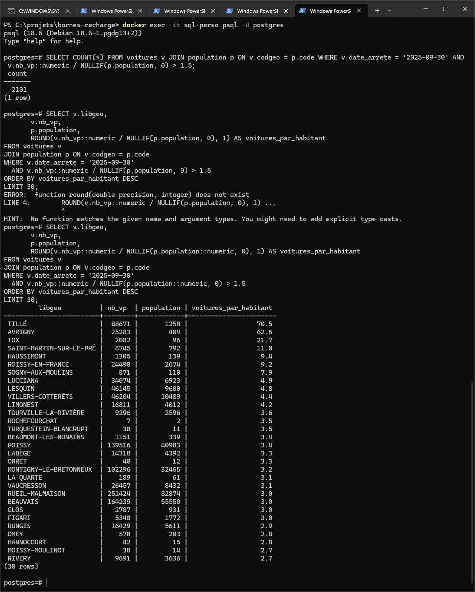
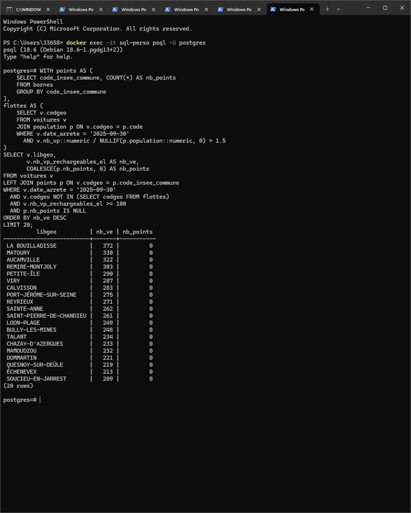
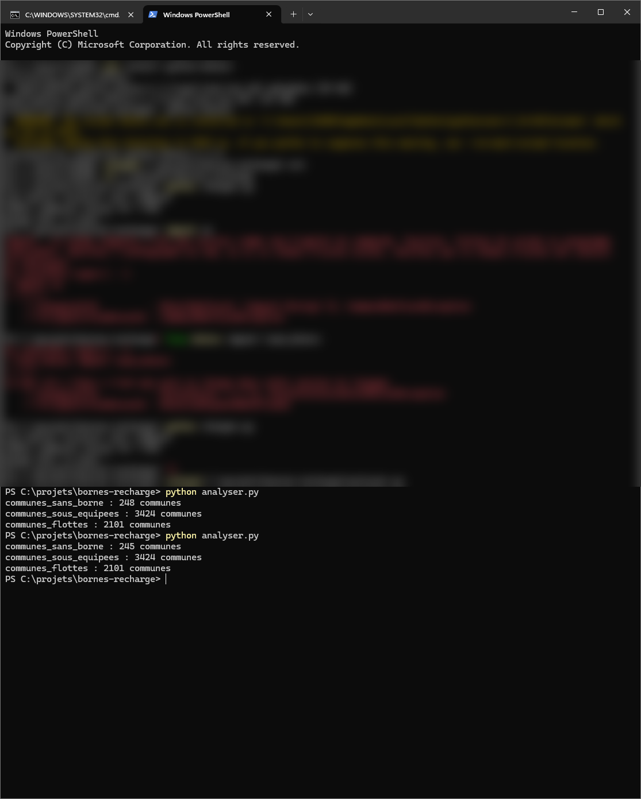

# Bornes de recharge : où manque-t-il des bornes en France ?

Pipeline de données de bout en bout, en Python et SQL, qui croise **le parc de voitures électriques** et **les points de recharge publics** de chaque commune française pour repérer celles qui sont **sans aucune borne** ou **sous-équipées**.

Le pipeline télécharge lui-même les données ouvertes, les nettoie, les range dans PostgreSQL, produit les résultats en CSV et **tourne tout seul chaque matin**.

> Auteur : **Youssef Sellaoui**, projet personnel de portfolio data engineering (octobre 2026).

---

## Les résultats (exécution du 06/10/2026)

| Liste | Communes | Fichier |
|---|---|---|
| Communes avec **au moins 100 voitures électriques et aucune borne publique** | **246** | `resultats/communes_sans_borne.csv` |
| Communes **sous-équipées** (voitures électriques par point de recharge) | **3 423** | `resultats/communes_sous_equipees.csv` |
| Communes « **sièges de flottes** », écartées du classement | **2 101** | `resultats/communes_flottes.csv` |

**Sans aucune borne publique** (extrait) : La Bouilladisse (372 VE), Matoury (330), Aucamville (322), Remire-Montjoly (303), Petite-Île (290), Viry (287)…

**Les plus sous-équipées** (extrait) :

| Commune | VE | Points de recharge | VE par point |
|---|---|---|---|
| Saint-Didier-au-Mont-d'Or | 802 | 2 | 401 |
| Saint-Ismier | 635 | 2 | 317,5 |
| Les Avirons | 312 | 1 | 312 |
| Harnes | 282 | 1 | 282 |
| Fillière | 554 | 2 | 277 |

**À qui ça sert** : installateurs et opérateurs de bornes (où sont les clients sans offre), collectivités (où investir), applications de recharge (zones mal couvertes).

---

## Comment ça marche

```
lancer.py  (lancé chaque jour à 7 h par le Planificateur de tâches Windows)
   │
   ├── 1. telecharger.py   → télécharge les 3 sources ouvertes dans data/
   ├── 2. charger.py       → nettoie, corrige les communes par GPS, range dans PostgreSQL
   └── 3. analyser.py      → exécute les requêtes de sql/ et écrit resultats/*.csv
```

- **Base de données** : PostgreSQL 18 dans un conteneur Docker (port limité au PC, volume persistant, redémarrage automatique).
- **Mot de passe** : jamais dans le code, rangé dans un fichier `.env` qui n'est pas publié.
- **Sécurité de la chaîne** : `check=True` : si une étape échoue, la suite ne tourne pas, donc jamais d'analyse sur des données cassées.

---

## Les sources (données ouvertes)

| Donnée | Source | Volume |
|---|---|---|
| Points de recharge (IRVE) | [Consolidation nationale, transport.data.gouv.fr](https://www.data.gouv.fr/datasets/beta-bases-nationales-des-points-de-recharge-pour-vehicules-electriques-en-france-irve) (mise à jour chaque nuit) | ~170 000 points, 116 Mo |
| Voitures par commune et type de recharge | [Agence ORE / AAA Data, data.gouv.fr](https://www.data.gouv.fr/datasets/voitures-particulieres-immatriculees-par-commune-et-par-type-de-recharge-jeu-de-donnees-aaadata) | 703 545 lignes (commune × trimestre) |
| Contours des communes | [Etalab, contours administratifs](https://etalab-datasets.geo.data.gouv.fr/contours-administratifs/latest/geojson/) (`communes-100m`) | 35 014 communes |
| Population | [API Géo, geo.api.gouv.fr](https://geo.api.gouv.fr) | 35 014 communes |

---

## Les pièges rencontrés et comment je les ai réglés

C'est la partie la plus importante du projet : **des données publiques « propres » ne le sont jamais**. Chaque correction a été vérifiée par des comptages avant et après.

**1. L'encodage.** Le fichier des voitures n'est pas en UTF-8 mais en latin-1 : `UnicodeDecodeError` sur le « É ». Corrigé avec `encoding="latin-1"`.

**2. Le zéro qui disparaît.** Le code commune `01022` lu comme un nombre devient `1022`, et la jointure échoue en silence. Les codes sont donc toujours lus comme du texte (`dtype=str`).

**3. Plus d'un quart des bornes sans commune.** 44 233 points de recharge n'avaient pas de code commune, mais tous avaient une position GPS. Je les ai rattachés à leur commune par **jointure spatiale** (GeoPandas : quel point tombe dans quel contour de commune).
Deux pièges dans le piège : les contours contiennent à la fois Paris, Lyon et Marseille **entiers** et leurs **arrondissements**, qui se superposent, donc j'ai retiré les villes entières. Et 175 bornes ont des coordonnées hors de France ou inversées (latitude et longitude échangées) : elles sont laissées de côté et documentées.



**4. Les codes faux.** 2 135 bornes avaient un code qui n'existe pas : code postal à la place du code INSEE (`86000`), code bidon `99999`, Paris entier `75056`. Une seule règle les attrape toutes : *une borne dont le code n'est pas dans la liste officielle est recorrigée par son GPS*. Il reste 222 bornes impossibles à placer, sur ~170 000.

**5. Les flottes d'entreprise.** Premier classement : Lucciana, Poissy, Sochaux en tête. Ce sont des sièges de loueurs et de constructeurs : les voitures y sont **immatriculées**, pas utilisées. Indice retenu : **voitures par habitant** (population via l'API Géo). Au-dessus de 1,5, la commune est écartée du classement et listée à part. Exemple : Villers-Cotterêts, 46 204 voitures pour 10 489 habitants.



**6. Les communes avec zéro borne étaient invisibles.** Avec une jointure simple (`JOIN`), une commune sans borne disparaît du résultat. Passer à un `LEFT JOIN` les a fait apparaître : ce sont souvent les cas les plus intéressants.



**7. Les petits nombres.** Seuil retenu : **au moins 100 voitures électriques** par commune, soit 3 754 communes qui représentent 76 % des VE de France. On évite ainsi qu'un village avec 3 VE et 0 borne fausse le classement. Contrôle de robustesse : le haut du classement reste quasi identique avant et après les corrections. Les corrections ont confirmé le résultat, elles ne l'ont pas fabriqué.

**8. Les communes qui changent de numéro.** Orée d'Anjou apparaissait n°2 des communes « sans borne » alors qu'elle en a. La cause : le fichier des voitures (2025) utilise l'ancien code `49069`, les contours et l'API (2026) le nouveau `49126`, après une fusion de communes. 184 codes sont concernés (0,2 % des VE). Seules les communes qui existent encore en 2026 sont gardées.



**9. Le raccourci Python de Windows.** `python` dans PowerShell pointe vers un alias de Windows (`WindowsApps\python.exe`) que le Planificateur de tâches peut ne pas suivre. La tâche utilise donc le vrai chemin de Python, et `lancer.py` utilise `sys.executable`.

**10. Les données changent toutes seules la nuit.** Le 06/10/2026, toutes les bornes de Guyane ont disparu de la consolidation nationale (0 point en Guyane). Cayenne, qui avait des bornes jusque-là, est passée d'un coup dans la liste « sans borne ». Le total national, lui, a augmenté (~170 500 points) : **une perte locale ne se voit pas dans un total**. Une source qui se met à jour seule peut changer les résultats sans prévenir. C'est la raison de la prochaine étape, les contrôles de qualité (voir plus bas).

Le détail complet (55 étapes, erreurs comprises) est dans [`JOURNAL.md`](JOURNAL.md), avec 27 captures d'écran dans [`captures/`](captures/).

---

## Limites connues

- Les données voitures sont arrêtées au **30/09/2025**, les bornes sont à jour du jour même : il y a un an d'écart entre les deux.
- Seuil « flottes » de 1,5 voiture/habitant : quelques faux positifs possibles (ex. Saint-Julien-du-Sault, 403 VE, 0 borne, classée flotte).
- Seules les bornes **publiques** sont comptées (pas les bornes à domicile ou en entreprise).
- La version actuelle tourne sur un PC : elle a besoin d'une session Windows ouverte.

---

## Lancer le projet

**Prérequis** : Python 3 et Docker.

```powershell
# 1. Base PostgreSQL dans Docker (choisir son propre mot de passe)
docker run -d --name sql-perso --restart unless-stopped -e POSTGRES_PASSWORD=<mot_de_passe> -p 127.0.0.1:5433:5432 -v sql-perso-data:/var/lib/postgresql postgres

# 2. Bibliothèques Python
pip install -r requirements.txt

# 3. Copier .env.example en .env et y mettre son mot de passe

# 4. Tout lancer : téléchargement, chargement, analyse
python lancer.py
```

Lancement quotidien : Planificateur de tâches Windows. Programme = chemin complet de `python.exe`, argument `lancer.py`, « Commencer dans » = dossier du projet.

---

## Structure du dépôt

```
bornes-recharge/
├── lancer.py            chef d'orchestre : enchaîne les 3 étapes
├── telecharger.py       télécharge les sources dans data/
├── charger.py           nettoyage, jointure spatiale, chargement PostgreSQL
├── analyser.py          exécute les requêtes SQL, écrit resultats/
├── sql/
│   ├── communes_sans_borne.sql
│   ├── communes_sous_equipees.sql
│   └── communes_flottes.sql
├── resultats/           les 3 listes en CSV (s'ouvrent dans Excel)
├── captures/            27 captures d'écran du projet
├── JOURNAL.md           journal détaillé, étape par étape
├── requirements.txt
├── .env.example         modèle du fichier secret (le vrai .env n'est pas publié)
└── LICENSE
```

---

## Prochaines étapes

- **Version 2 : migration sur AWS.** Fichiers dans S3, traitement dans Lambda, réveil quotidien par EventBridge, requêtes SQL avec Athena. Ce sont des outils payés à l'usage plutôt qu'une base allumée en continu.
- **Contrôles de qualité automatiques** : comparer chaque jour le nombre de bornes par département avec la veille, et alerter en cas de chute anormale (cf. piège n°10).
- **Table de passage INSEE** (anciens codes vers nouveaux codes) pour récupérer les communes fusionnées au lieu de les écarter.

---

## Outils

Python (pandas, GeoPandas, SQLAlchemy, psycopg, python-dotenv) · SQL (PostgreSQL 18 : CTE, `LEFT JOIN`, `COALESCE`, `NULLIF`) · Docker · API REST · Planificateur de tâches Windows · Git / GitHub

## Licence

[MIT](LICENSE) : libre réutilisation, à condition de conserver le nom de l'auteur.
